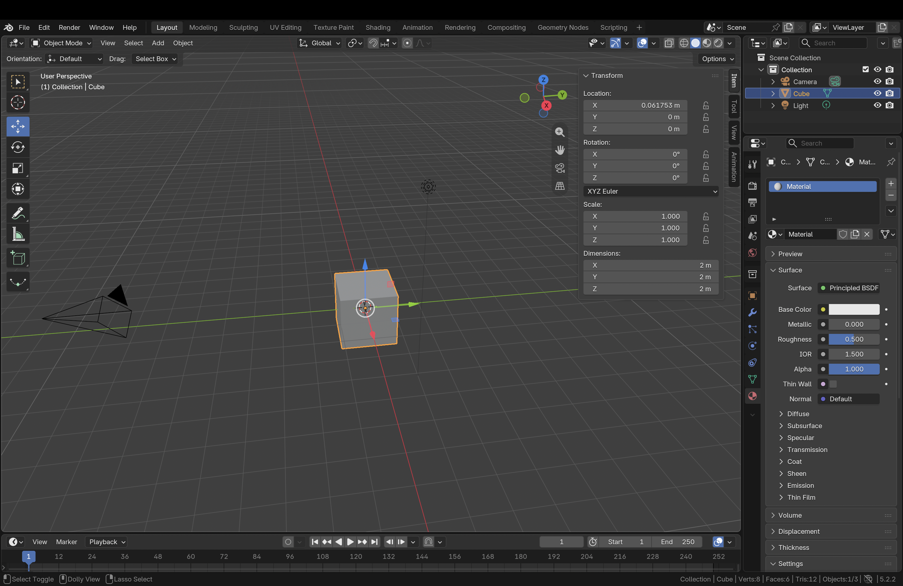

# BLENDER-NOTES.md — Assignment 3

Blender 5.2.2 (macOS, Apple Silicon), "Learn the window" session on 12 October 2026, before any prompting.
The six descriptions below are in my own words, written while exploring. Claude only organised them into this file and tidied grammar.

*Screenshot of my own Blender session: the default cube is selected (orange outline), the sidebar is open showing Location, Rotation, Scale and Dimensions, and Scene Statistics in the status bar shows Verts 8, Faces 6, Tris 12.*

## Moving around the viewport

- **Orbit:** dragging the coloured X/Y/Z axis ball in the top-right of the viewport rotates the view around the scene. Two-finger swipe on the MacBook trackpad also orbits.
- **Zoom:** clicking the magnifier icon once did nothing (it needs click-hold-drag). Pinching on the trackpad zooms.
- **Pan:** Shift + two-finger swipe on the trackpad slides the view left, right, up and down without rotating.

## The six parts of the interface

1. **3D Viewport:** The 3D Viewport is where I can see and work on the objects in my scene. I can rotate the view, zoom in or out, and pan to look at them from different angles.
2. **Toolbar:** The toolbar is the strip of icons on the left edge of the viewport. It has tools to select, place the 3D cursor, move, rotate, scale, transform, annotate, measure, and add a cube. When I picked Move and dragged one of the arrows, the cube moved along that direction.
3. **Outliner:** The Outliner is the panel in the top-right that lists everything in my scene (Collection, Camera, Cube, Light). Clicking a name highlights that object in the viewport, and clicking the eye icon next to it made the cube disappear from view.
4. **Properties editor:** The Properties editor is the bottom-right panel with a column of tabs down its side, each showing settings for the selected object. In the Material tab I saw a material named "Material" with settings like Base Color, Metallic, Roughness, IOR, and Alpha. These look like controls for changing the cube's colour and how its surface looks.
5. **Sidebar:** Pressing N over the viewport opens the sidebar. Its Item tab shows the selected object's Location, Rotation, Scale, and Dimensions, each with X, Y, and Z values. The default cube's dimensions are 2 m × 2 m × 2 m.
6. **Mode selector:** The dropdown at the top-left of the viewport switches modes. In Edit Mode, I can see the cube's corner points and edges highlighted, with more editing tools in the toolbar. In Object Mode, the cube is selected as a whole and has the move arrows. Object Mode is for working with the whole object, while Edit Mode is for changing individual parts of its shape.

## Other things I noticed

- The red line through the scene is the X axis and the green line is the Y axis. Right-clicking in the viewport opens the Object context menu, not the status-bar menu.
- The status bar is the thin strip below the timeline numbers; the Blender version (5.2.2) shows at its bottom-right. Right-clicking it and ticking **Scene Statistics** shows vertex, face and triangle counts.
- The default cube is 12 triangles. A default UV Sphere is 960 triangles on its own, more than the 500-per-asset limit. Changing it to 12 segments and 6 rings dropped it to about 120 triangles; its outline still looked round but slightly angular.
